<picture>
  <source media="(prefers-color-scheme: dark)" srcset="header-dark.svg">
  
</picture>

### `$ whoami`

I write TypeScript, mostly NestJS backends: Discord and Telegram bots, NFT tools built on OpenSea data, a Markdown converter for HTML pages and PDFs, and tooling for Claude Code.

Italy

### `$ tree stack/`

```text
stack/
├── languages/
│   ├── TypeScript   87.9%
│   ├── JavaScript   11.5%
│   ├── HTML          0.4%
│   ├── Shell         0.1%
│   ├── Dockerfile    0.0%
│   └── CSS           0.0%
├── frameworks/
│   └── NestJS
└── tooling/
    ├── tests: 6 of 9
    ├── CI: 6 of 9
    └── container: 2 of 9
```

<sub>Generated with [dotprofile](https://github.com/priotts/dotprofile-skill) from facts read from my repositories.</sub>
